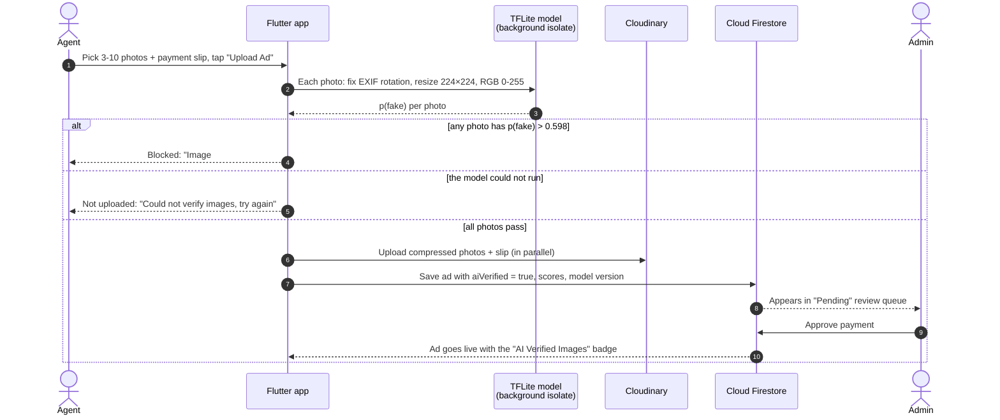
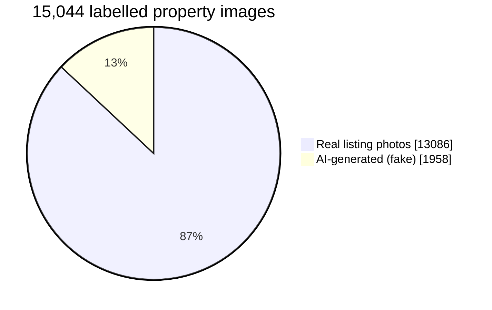
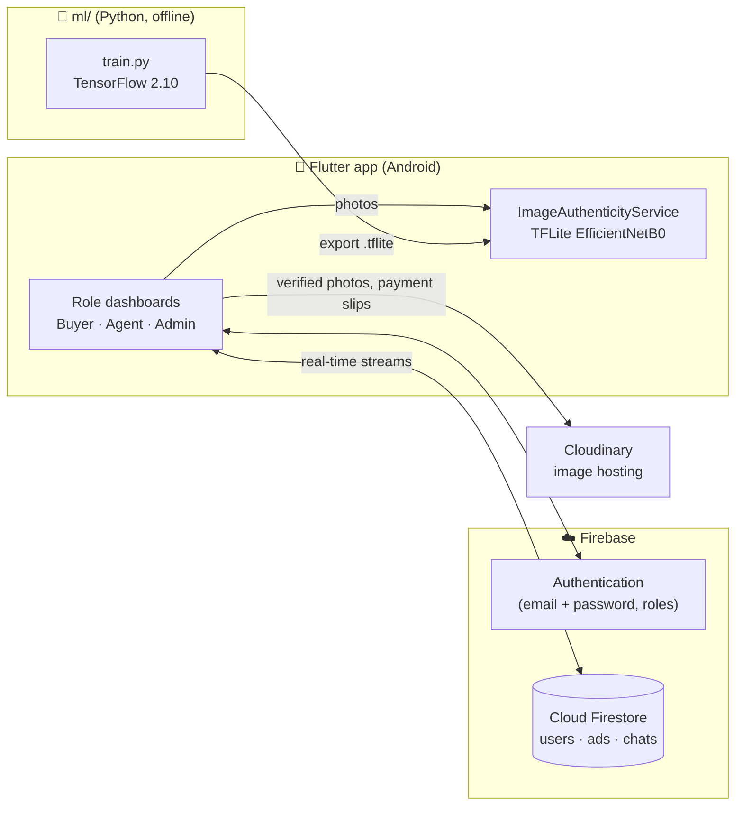
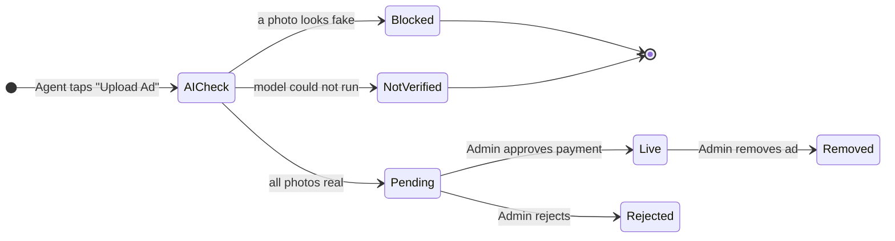

<div align="center">


# Roofinity

**A real-estate marketplace app that blocks fake, AI-generated property photos before they are ever posted.**

A Flutter + Firebase app for buyers, agents and admins, with a custom-trained EfficientNetB0 model running **on the device** through TensorFlow Lite.


[](LICENSE)

[Download the APK](https://github.com/SMAmjad/Roofinity-House-Sale-Purchase-App/releases/latest) · [How the AI works](#how-the-ai-check-works) · [Run it locally](#getting-started) · [Train the model](ml/README.md)

</div>

---

## The problem

Image generators now make it trivial to create a photorealistic "dream home" that does not exist. On a property marketplace, such pictures can be used to bait buyers into fake listings, and human moderators cannot reliably spot them. By the time a buyer finds out, they have wasted a site visit or worse.

**Roofinity checks every listing photo with a computer-vision model the moment an agent tries to post it.** If any image looks AI-generated, the ad is blocked on the spot, and the agent is told exactly which photo failed. Listings that pass carry an **"AI Verified Images"** badge that buyers can see.

## Highlights

- **Custom computer-vision model.** EfficientNetB0 trained with transfer learning and fine-tuning on **15,044 labelled property images**, with a decision threshold tuned to catch at least 90% of fake images. ([training details](ml/README.md))
- **Fully on-device inference.** The 4.4 MB quantised TFLite model runs in a background isolate, so it is private (photos are checked before they leave the phone), works offline and keeps the UI smooth.
- **Fail-closed safety.** If the model cannot run, the ad is not posted. A broken check can never silently approve an image.
- **Three complete user roles.** Buyer, Agent and Admin, each with its own dashboard, backed by Firebase Auth and Cloud Firestore in real time.
- **End-to-end marketplace.** Listings, search and price filters, favourites, buyer-agent chat, payment-slip verification, a "Trusted Agent" badge and an FAQ assistant.
- **Engineered for reproducibility.** Pinned ML dependencies, a committed model checkpoint, tests that keep the Dart and Python preprocessing in sync, and CI on every push.

## Features by role

| Buyer | Agent (seller) | Admin |
|---|---|---|
| Browse live listings with photo carousels | Post ads with 3-10 photos, **AI-checked before upload** | Review queue with tabs: Pending / Approved / Rejected |
| Search by title, filter by price range | See which photo failed and its fake score | See every ad's photos, AI score and payment slip together |
| "AI Verified Images" badge on listings | Track each ad: *Waiting for approval* → *Live* | Approve or reject: approval makes the ad live |
| Save favourites | Chat with interested buyers | Remove live ads |
| Chat with the listing agent | "Trusted Agent" badge after 5 approved ads | |
| FAQ assistant | FAQ assistant | |

## How the AI check works



The model is an **EfficientNetB0** image classifier (real vs. fake) trained in two stages, first with a frozen ImageNet backbone and then fine-tuning the top layers. The threshold `0.598` was selected on held-out data as the point with the best precision that still catches at least 90% of fake images, because letting a fake listing through costs more than asking an agent to retake a photo.

Implementation: [`lib/utils/image_authenticity_service.dart`](lib/utils/image_authenticity_service.dart) · Training pipeline: [`ml/`](ml/README.md)

### Training data



Split 80/10/10 (train 12,035 · validation 1,504 · test 1,505), stratified by class. The full pipeline (dataset prep → training → threshold selection → TFLite export → evaluation with confusion matrix, ROC and PR curves) lives in [`ml/`](ml/README.md).

## Architecture



### Ad lifecycle



### Firestore data model

| Collection | Key fields |
|---|---|
| `users/{uid}` | `name`, `email`, `role` (`Buyer` / `Seller` / `Admin`), `akraId` (agents), `favorites[]` |
| `ads/{adId}` | `title`, `price`, `description`, `imageUrls[]`, `paymentSlipUrl`, `paymentStatus`, `sellerId`, `aiVerified`, `aiCheck { verdict, maxFakeScore, fakeScores[], threshold, modelVersion, checkedAt }` |
| `chats/{buyerId_agentId}` | `participants[]`, `buyerName`, `sellerName`, `lastMessage`, `lastMessageTime` |
| `chats/{id}/messages/{msgId}` | `senderId`, `text`, `timestamp` |

## Tech stack

| Layer | Technology |
|---|---|
| Mobile app | Flutter, Dart 3 |
| On-device AI | TensorFlow Lite (`tflite_flutter`), `image` for decoding/resizing, Dart isolates |
| Backend | Firebase Authentication, Cloud Firestore |
| Media | Cloudinary (unsigned uploads), `flutter_image_compress` |
| ML training | Python, TensorFlow/Keras 2.10, EfficientNetB0, scikit-learn, Matplotlib |
| Quality | `flutter_test`, `pytest`, GitHub Actions |

## Project structure

```
.
├── lib/
│   ├── admin/        # review queue (ads + payments), live-ad management
│   ├── buyer/        # listings, search & filters, details, gallery, favourites
│   ├── seller/       # agent dashboard, upload ad (AI check), my ads
│   ├── chat/         # buyer ↔ agent chat, FAQ assistant
│   ├── login/        # sign in / sign up (role selection, AKRA ID for agents)
│   ├── services/     # auth, Firestore, favourites, chatbot
│   ├── utils/        # image_authenticity_service.dart (AI), Cloudinary, routing
│   ├── widgets/      # shared UI (AI Verified badge, buttons, fields)
│   └── config/       # build-time payment settings
├── assets/
│   ├── false_property_detector.tflite   # the trained model
│   └── data/chatbot_data.json           # FAQ assistant knowledge base
├── ml/               # dataset prep, training, evaluation, CLI + desktop tester
├── test/             # Flutter unit tests
└── .github/workflows/ci.yml
```

## Getting started

### Prerequisites

- Flutter SDK (stable channel, Dart 3.9 or newer)
- Android Studio or the Android SDK, plus JDK 17+
- An Android phone or emulator

### Run

```bash
git clone https://github.com/SMAmjad/Roofinity-House-Sale-Purchase-App.git
cd Roofinity-House-Sale-Purchase-App
flutter pub get
flutter run
```

The repository already contains the Firebase client configuration and the trained model, so the app runs against the live project straight after cloning. In VS Code, pick **"Roofinity (demo values)"** in the Run panel.

### Payment details (optional)

The bank details shown on the *Upload Ad* screen are injected at build time so the real account number is never committed:

```bash
cp payment.example.json payment.json      # then edit payment.json (git-ignored)
flutter run --dart-define-from-file=payment.json
flutter build apk --release --dart-define-from-file=payment.json
```

Without `payment.json`, placeholder values are shown.

### Admin access

Sign in with `admin@roofinity.com`. On the very first sign-in the admin account is created in Firebase Authentication with the password you enter. After that, that password is required.

### Tests

```bash
flutter analyze
flutter test                      # Dart unit tests
cd ml && pytest -q                # preprocessing contract + model/threshold sync
```

## Using your own Firebase project

1. Create a Firebase project, enable **Email/Password** sign-in and **Cloud Firestore**.
2. Run `flutterfire configure` to regenerate `lib/firebase_options.dart`.
3. Set your Cloudinary cloud name and *unsigned* upload preset in `lib/utils/cloudinary_service.dart`.

## Security notes

- Firebase client keys in `lib/firebase_options.dart` are public identifiers, not secrets. Access must be enforced with **Firestore Security Rules**: users can edit only their own profile and ads, and only admins can change `paymentStatus`.
- The Cloudinary preset is unsigned, so anyone with the app can upload to it. For production, move uploads behind a signed endpoint (for example a Cloud Function).
- Release builds are currently signed with the debug key. Create an upload keystore before publishing to the Play Store.

## Roadmap

- [ ] Server-side re-check of images (Cloud Function) so the AI verdict cannot be bypassed by a modified client
- [ ] Firestore Security Rules + emulator tests
- [ ] Grad-CAM heat-maps showing *why* a photo was flagged
- [ ] More diverse fake images (other generators) to improve generalisation
- [ ] iOS build and Play Store release

## License

Released under the [MIT License](LICENSE). © 2026 Sheikh Muhammad Amjad.
